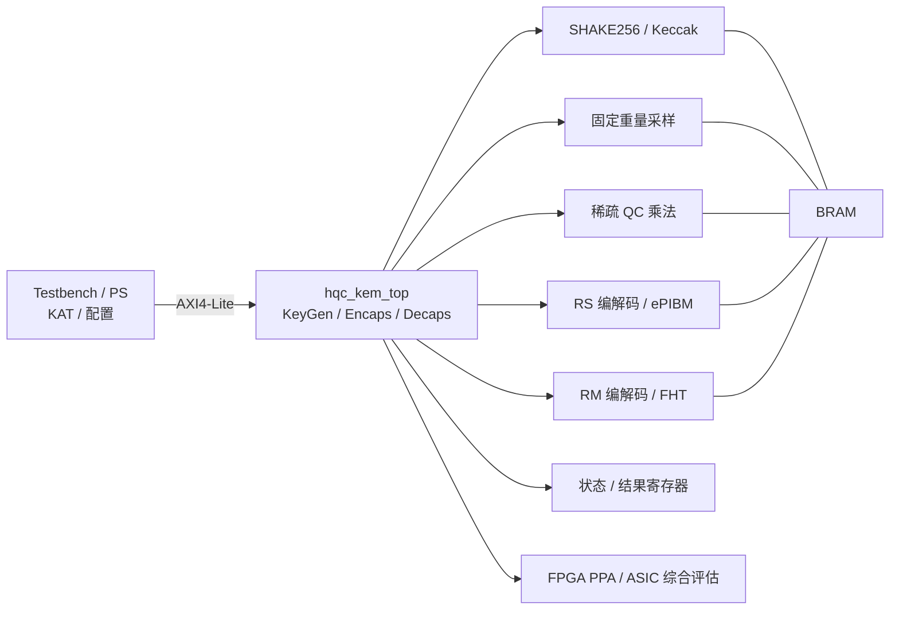

# HQC-KEM-FPGA/ASIC：面向后量子密码 HQC 的完整 RTL 与 FPGA/ASIC 实现

> 南京大学大创项目 · 田静老师课题组方向 · 后量子密码（PQC）· 码密码 HQC
> **主题：完整 RTL 的 HQC-128 KEM → FPGA 原型 + ASIC 综合评估**
> **目标：2027-05-31 前完整 RTL 跑通 + 官方 KAT 100/100**

## 项目简介

HQC-KEM-FPGA/ASIC 用**完整 RTL** 实现 HQC-128 KEM（KeyGen / Encaps / Decaps + FO + 隐式拒绝），
用官方 KAT 逐字节验证，给出 FPGA PPA，并在条件允许时做 ASIC 综合评估（area/power/fmax，不流片）。

当前已完成官方参考实现/KAT **100/100（pk/sk/ss）**；完整 RTL 按
[`docs/14_总体工作计划.md`](docs/14_总体工作计划.md) 分阶段推进。

## 系统架构



## 当前状态

| 项 | 状态 |
|:---|:---|
| 官方 KAT | ✅ 100/100（pk/sk/ss） |
| 完整 RTL | 🟡 分阶段推进 |
| FPGA 全功能跑通 | ⬜ 硬目标（AC701 200T） |
| FPGA PPA | ⬜ 待做 |
| ASIC 综合 | ⬜ 条件阶段；PDK 55/28/90nm，工具待确认 |
| 目标 | 2027-05-31 前 FPGA 全跑通 |

> **开工前必读**：[开发流程与硬约束](docs/workflow.md) · [古法编程](skill/gufa-programming/SKILL.md) · [理解门槛](skill/understand-gate/SKILL.md) · [契约冻结](skill/contract-freeze-workflow/SKILL.md)
> **没有冻结契约，不许写代码；单步 ≤100 行；commit 前 3 题。**

---

## 一、项目一句话

用 **完整 RTL** 实现 HQC-128 KEM（KeyGen / Encaps / Decaps + FO + 隐式拒绝）：

- **RTL**：SHAKE256、固定重量采样、RS 编解码、RM FHT、稀疏准循环乘法、KEM 控制、AXI/MMIO；
- **软件**：官方 HQC 参考实现 + C/C++ 黄金 + KAT，用于逐字节对拍；
- **仿真**：Vivado xsim 系统级仿真 + 官方 KAT；
- **FPGA**：**全功能跑通（板端 KAT 100/100 + KeyGen/Encap/Decap）** + 综合/实现 PPA；
- **ASIC**：55nm 主、28nm 对比、90nm 兜底；只做综合 + area/power/fmax，**不跑 P&R、不流片**。

> 组内 SOCC 2023 已经做了 **FPGA 完整 HQC-128 KEM**。
> 我们的差异化不靠“重复造稀疏乘法/完整 KEM”，而靠 **完整 RTL + ASIC 评估 + 设计空间 + 开源可复现**。

---

## 二、为什么换主题

| 旧方案（已保存到 `hqc-baseline` 分支） | 新方案 |
|:---|:---|
| PS+PL 混合，C/C++ 做 SHAKE/RS | **完整 RTL**，所有模块上 PL |
| 仿真优先，上板最后再定 | **FPGA 全功能跑通 + ASIC 综合评估** |
| 稀疏乘法 + 完整 KEM 当主线 | 稀疏乘法/FHT/RS/KEM 是**基线**；ASIC 与设计空间是增量 |

组内 SOCC 2023 的边界：

- 已做：稀疏乘法、RM FHT、RS ePIBM、完整 HQC-128 KEM；
- 结果：19,794 LUT / 11,079 FF / 68 BRAM / 178 MHz；
  KeyGen/Encap/Decap = 0.11 / 0.22 / 0.38 ms（Artix-7 xc7a200t-3）。

**所以**：稀疏乘法、FHT、RS、完整 KEM 都不能当原创；ASIC 评估是更明确的差异点。

---

## 三、范围分层

| 层级 | 内容 | 硬闸门 |
|:---|:---|:---|
| **V0 完整 RTL** | HQC-128 全 RTL（SHAKE/采样/RS/RM/乘法/控制） | ✅ |
| **V0 验证** | 官方 KAT 100/100 + xsim 系统仿真 | ✅ |
| **V1 FPGA** | **板端全功能跑通 + KAT 100/100** + 综合/实现 PPA | ✅ **硬目标** |
| **V2 ASIC** | 55nm 主 / 28nm 对比 / 90nm 兜底；只做综合 + area/power/fmax | 🟡 条件 |
| **V3 ASIC P&R/流片** | DRC/LVS/signoff/MPW | ⬜ **明确不做（老师已确认不流片）** |

**V0 不做**：HQC-192/256、掩码/侧信道、MPW、全参数集。

> 主开发板：**AC701 XC7A200T（苏州）**；备选 **XC7A100T**；备用 200T（常州）。
> Artix-7 无 ARM PS，板端 KAT 走 UART/JTAG/AXI，不照搬 PYNQ overlay。

---

## 四、模块与接口

> 架构图见本页顶部；这里只列模块与负责人。

| 模块 | 职责 | 负责人 |
|:---|:---|:---|
| `sha3/keccak` | SHAKE256、XOF、PRNG | 骆弈宾 |
| `sampler` | 固定重量采样（w/w_r/w_e） | 骆弈宾 |
| `sparse_qc_mult` | dense×sparse 准循环乘法 | 曹子墨 |
| `rs_codec` | RS 编码 + ePIBM/BM 解码 | 曹子墨 |
| `rm_codec` | RM 编码 + FHT 解码 + 重复合并 | 曹子墨 |
| `hqc_kem_top` | KeyGen/Encaps/Decaps、FO、隐式拒绝 | 骆弈宾 |
| `axi_mmio` | 寄存器/BRAM/DMA | 骆弈宾 |
| `tb/golden` | KAT、C 黄金、系统仿真、PPA | 江力博 |

详细路线见 [docs/12_FPGA_ASIC路线.md](docs/12_FPGA_ASIC路线.md)；
总体工作表见 [docs/14_总体工作计划.md](docs/14_总体工作计划.md)。

---

## 五、里程碑（半年排期）

> 详细排期见 [docs/14_总体工作计划.md](docs/14_总体工作计划.md)；主计划见 [plan.md](plan.md)。

| 里程碑 | 时间 | 交付 | 验收 |
|:---|:---|:---|:---|
| M0 基线 | 2026-11-30 | 参考实现、KAT、契约草案 | KAT `100/100 (pk/sk/ss)` |
| M1 模块 RTL | 2027-01-31 | SHAKE/采样/RS/RM/乘法 | 模块 tb `PASS`；0 mismatch |
| M2 完整 RTL | 2027-03-15 | KEM Top、系统仿真 | 完整 KAT `100/100`；0 mismatch |
| M3 FPGA | 2027-04-30 | 板端全功能 + PPA | 板端 KAT `100/100`；PPA 报告 |
| M4 ASIC（条件） | 2027-05-15 | 55/28/90nm 综合 | area/power/fmax 或降级说明 |
| M5 收尾 | 2027-05-31 | 报告/答辩/冻结 | 全套材料 |
| 缓冲 | 2027-06 | 只修 bug/答辩 | 不加功能 |

---

## 六、指标

### 6.1 功能

- HQC-128 完整 KEM，**全 RTL**；
- 官方 KAT **100/100**（先 keygen+decaps，再补 encaps ct）；
- 系统仿真 100/100；0 mismatch；
- 负向：篡改 ct → 隐式拒绝。

### 6.2 FPGA（V1）

| 指标 | 目标 |
|:---|:---|
| 器件 | **AC701 XC7A200T（主）**；小梅哥 XC7A100T（备）；常州 200T（备用） |
| 参考基线 | SOCC 2023：19,794 LUT / 11,079 FF / 68 BRAM / 178 MHz |
| **全功能跑通** | **板端 KeyGen/Encap/Decap + KAT 100/100** |
| 我们的目标 | 先“能放、能跑、KAT 过”，再优化；不承诺超过论文 |
| 周期/延迟 | KeyGen/Encap/Decap 的 cycles 与 ms |
| PPA | LUT/FF/BRAM/DSP/Fmax/cycles |

### 6.3 ASIC（V2，条件）

| 指标 | 目标 |
|:---|:---|
| 流程 | 综合 + area/power/fmax（**不跑 P&R、不流片**） |
| PDK | **55nm 主 / 28nm 对比 / 90nm 兜底** |
| 工具 | 待确认；假设至少有一种（DC/Genus/OpenROAD） |
| 输出 | 面积、功耗、频率、能效；与 FPGA 对比 |
| 风险 | 团队无 ASIC 经验；没有工具就降级为 ASIC 导向 RTL + FPGA PPA |

---

## 七、四人分工

| 成员 | 角色 | 负责 | 备注 |
|:---|:---|:---|:---|
| **江力博** | 项目负责人 / FPGA 与系统集成 | 进度、Vivado 平台 owner、FPGA bring-up、系统仿真、PPA、repo/CI、ASIC 协调 | **不写 RTL**；总览项目 |
| **房煦然** | 与老师对接 / 需求与验证 | 需求/范围、架构/契约、老师沟通、**C 黄金 + KAT/验证**、原创性/差异表、验收/答辩 | **不写 RTL**；总览项目 |
| **骆弈宾** | RTL-A：协议/SHAKE/控制 | SHAKE256、固定重量采样、KEM/PKE 控制、FO/隐式拒绝 | RTL 主力 |
| **曹子墨** | RTL-B：算术/解码 | 稀疏乘法、RS 编解码、RM FHT、重复合并 | RTL 主力 |

- **RTL 线由骆弈宾、曹子墨负责；江力博不写 RTL**，负责 FPGA bring-up / Vivado / 系统集成 / PPA；
- 房煦然不写 RTL，负责 **C 黄金 + KAT/验证** + 需求/契约/验收；
- 当前只有江力博的机器有 Vivado：他周五统一跑 xsim + OOC 综合；其他人用 iverilog/Verilator 预检；
- 详细任务与验收见 [docs/13_开工清单与近期任务.md](docs/13_开工清单与近期任务.md)。

---

## 八、仓库结构

```text
dachuang/
├─ README.md
├─ plan.md
├─ AGENTS.md
├─ docs/
│  ├─ 00_新队友阅读顺序.md
│  ├─ 01_田静老师资料与研究方向.md
│  ├─ 03_前置知识与学习路线.md
│  ├─ 04_GitHub与Git一天上手指南.md
│  ├─ 05_前置知识补全_从数电到Verilog实战.md
│  ├─ 06_协作纪录与技能提炼规范.md
│  ├─ 07_新手使用Agent教程.md
│  ├─ 08_HQC技术路线.md
│  ├─ 09_工程约束与验证规范.md
│  ├─ 10_团队分工与国家级指标.md
│  ├─ 11_组内基线与差异表.md
│  ├─ 12_FPGA_ASIC路线.md
│  ├─ 13_开工清单与近期任务.md
│  ├─ 14_总体工作计划.md
│  ├─ 16_基础补齐清单.md
│  ├─ workflow.md              # 开发流程与硬约束
│  ├─ contracts/
│  └─ records/
├─ src/                       # 完整 RTL
├─ sim/                       # tb、xsim、系统仿真
├─ models/
│  ├─ golden/                 # 独立算术黄金
│  └─ kem/harness/            # 官方 KAT 对拍
├─ third_party/hqc/           # 官方 HQC 参考实现（public domain）
├─ data/                      # 向量、黄金、日志、证据
├─ build/constraints/         # XDC
├─ asic/                      # ASIC 综合脚本（V2）
├─ board/                     # FPGA 全功能跑通（硬目标）
├─ report/                    # 报告 + llm_log
└─ skill/                     # 团队技能
```

---

## 九、快速开始

### 1. 官方 KAT（A1 已通过）

WSL：

```bash
bash models/kem/harness/run.sh
# PASS: 100/100 vectors (pk/sk/ss)
```

### 2. C 黄金

```bash
make -C models/golden
./build/golden/qc_mult_ref --selftest
# PASS: 5/5 checks
```

### 3. Vivado xsim

```powershell
.\sim\run.ps1 rtl tb_sparse_qc_mult_n17669
```

通过标准：`PASS: N/N checks`。

---

## 十、原创性与贡献边界

组内 SOCC 2023 已做：稀疏乘法、RM FHT、RS ePIBM、完整 FPGA KEM。
**这些不能当原创。**

| 内容 | 来源 | 本项目工作 |
|:---|:---|:---|
| 稀疏乘法 | SOCC 2023 / LEAP | ❌ 不能当原创；做设计空间 |
| RM FHT | SOCC 2023 | ❌ 不能当原创；实现/验证 |
| RS ePIBM | SOCC 2023 | ❌ 不能当原创；实现/验证 |
| 完整 FPGA KEM / 全功能跑通 | SOCC 2023 | ❌ 不能当原创；是硬目标但不是唯一创新 |
| **ASIC 多工艺综合（55/28/90nm）** | 本项目 | ✅ **主要差异点** |
| **FPGA/ASIC 设计空间** | 本项目 | ✅ 候选增量 |
| 参数化（192/256）/开源可复现 | 本项目 | ✅ 加分项 |
| RISC-V/恒定时间 | 本项目（选做） | ✅ 可选 |

**不能写**：“首次实现 HQC 硬件”“稀疏乘法是我们的创新”“完整 KEM 是我们的创新”“FPGA 全跑通是我们的创新”。

> 国家级增量 = **ASIC 多工艺综合 + 设计空间 + 参数化/开源**；
> 老师已确认**不流片**，所以只做综合评估，P&R/tapeout 不写进目标。

---

## 十一、文档导航

1. [开发流程与硬约束](docs/workflow.md) — **开工必读**
2. [GitHub 与 Git 一天上手指南](docs/04_GitHub与Git一天上手指南.md)
3. [田静老师资料与研究方向](docs/01_田静老师资料与研究方向.md)
4. [HQC 技术路线](docs/08_HQC技术路线.md)
5. [工程约束与验证规范](docs/09_工程约束与验证规范.md)
6. [团队分工与国家级指标](docs/10_团队分工与国家级指标.md)
7. [组内基线与差异表](docs/11_组内基线与差异表.md) — **原创性必读**
8. [FPGA/ASIC 路线](docs/12_FPGA_ASIC路线.md) — **新主题主线**
9. [开工清单与近期任务](docs/13_开工清单与近期任务.md) — **本周任务**
10. [总体工作计划](docs/14_总体工作计划.md) — **到 2027-06 的排期**
11. [基础补齐清单](docs/16_基础补齐清单.md) — **只学过数电+信号与系统先读**
12. [前置知识与学习路线](docs/03_前置知识与学习路线.md)
13. [前置知识补全：从数电到 Verilog 实战](docs/05_前置知识补全_从数电到Verilog实战.md)
14. [协作纪录与技能提炼规范](docs/06_协作纪录与技能提炼规范.md)
15. [新手使用 Agent 教程](docs/07_新手使用Agent教程.md)

**接口契约**：[docs/contracts/](docs/contracts/README.md)
**项目管理**：[plan.md](plan.md) · [AGENTS.md](AGENTS.md)
**工程入口**：[models/README.md](models/README.md) · [sim/README.md](sim/README.md) · [data/README.md](data/README.md) · [build/constraints/README.md](build/constraints/README.md) · [board/README.md](board/README.md) · [report/README.md](report/README.md)

---

## 十二、当前状态

- [x] 主题切换：完整 RTL HQC KEM + FPGA/ASIC 评估
- [x] 官方 HQC 参考实现 vendor（`third_party/hqc`，public domain）
- [x] A1：KAT keygen + decaps **100/100**（pk/sk/ss）；C 黄金 `5/5`
- [x] 单路 `sparse_qc_mult` baseline；N=17669 折叠 `831/831`（旧分支 `hqc-baseline`）
- [x] 板卡选型：AC701 XC7A200T 主；XC7A100T 备；常州 200T 备用
- [x] 古法编程 + 契约冻结流程；协作纪录统一到 `report/llm_log/`
- [ ] A2：encaps ct 字节级一致（需要 NIST DRBG/OpenSSL）
- [ ] M0（2026-11-30）：契约草案 + 分支/任务/证据目录就绪
- [ ] M1（2027-01-31）：完整 RTL 契约冻结；SHAKE/采样/RS/RM/乘法 tb `PASS`
- [ ] M1（2027-01-31）：稀疏乘法 N=17669 随机 1000 组 + OOC 综合
- [ ] M2（2027-03-15）：KEM Top + 系统仿真 100/100 KAT
- [ ] M3（2027-04-30）：**FPGA 全功能跑通（板端 KAT 100/100）+ PPA**
- [ ] M4（2027-05-15，条件）：ASIC 综合（55nm 主 / 28nm 对比 / 90nm 兜底；不流片）
- [ ] M5（2027-05-31）：报告/答辩/冻结；2027-06 只修 bug

> `hqc-baseline` 已合并最新文档与协作纪录；旧的“PS+PL 混合、仿真优先”实现仍保留在该分支历史中。
