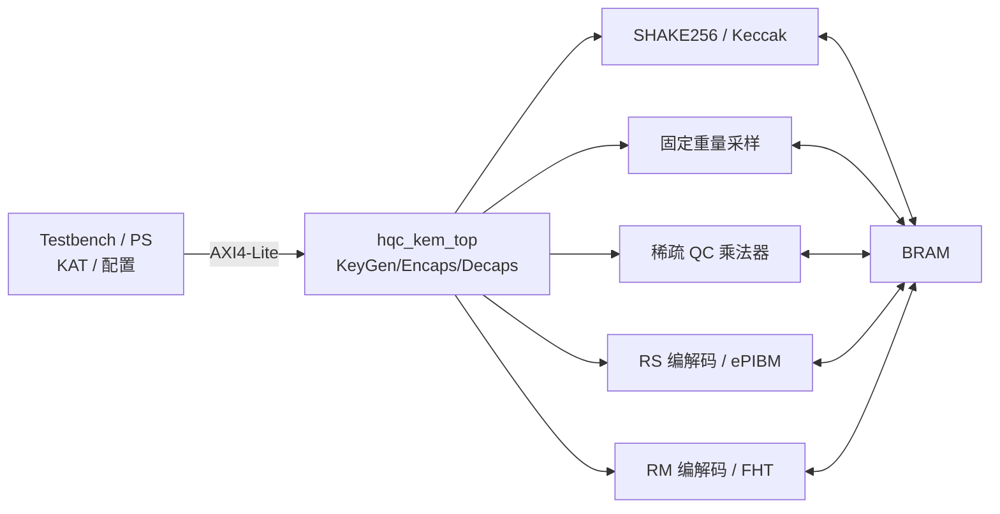

# HQC 技术路线与原创点

> 本文是 HQC KEM 大创的技术主线。读完后应能回答：
> ① HQC 在算什么；② 瓶颈在哪；③ 为什么稀疏结构能救乘法；④ 你的原创点是什么。
> 参数、填充、重复码等细节**以官方 HQC spec 与参考实现为准**；本文只给工程所需的全局图。

---

## 一、HQC 是什么

HQC（Hamming Quasi-Cyclic）是**基于准循环码的 KEM**，NIST 于 2025 年将其选为第五个后量子密码标准算法。它的安全性来自“解码随机准循环码”的困难性，属于**码密码**，不是格密码。

| 维度 | HQC | Kyber |
|:---|:---|:---|
| 困难问题 | 准循环码解码 | Module-LWE |
| 运算域 | $\mathrm{GF}(2)[X]/(X^n-1)$ | $\mathbb{Z}_q$，$q=3329$ |
| 核心 | 准循环乘法 + RM/RS 解码 | NTT + 模约减 |
| 你的旧论文 | 不适用 | FLUT+KRED |

**结论**：Kyber 的 FLUT+KRED 不能直接搬；但“从算法结构里找硬件简化”的方法完全适用。

---

## 二、参数与码结构

| 参数集 | n | k（字节） | w | w_r | w_e | RS 的 n1 |
|:---|:---|:---|:---|:---|:---|:---|
| HQC-128 | 17669 | 16 | 66 | 75 | 75 | 46 |
| HQC-192 | 35851 | 24 | 100 | 114 | 114 | 56 |
| HQC-256 | 57637 | 32 | 131 | 149 | 149 | 90 |

- `w`：私钥 x / y 的固定重量；
- `w_r`：加密随机向量 r1 / r2 的固定重量；
- `w_e`：误差 e 的固定重量；
- 码：Reed-Solomon（GF(2⁸)）× Reed-Muller RM(1,7)[128,8,64] × 重复码；
- `n` 为素数，级联码长度略小于 n，存在填充/缩短规则，**以官方 spec 为准**。

---

## 三、KEM 流程

### KeyGen

1. 生成种子，采样 x、y（重量 w）；
2. 生成稠密 h；
3. `s = x + h·y`（dense × sparse）；
4. 输出 `pk = (h, s)`，`sk = (x, y)`。

### Encaps

1. 随机 m；SHAKE 生成 r1、r2、e；
2. `u = r1 + h·r2`（dense × sparse）；
3. `v = Encode(m) + s·r2 + e`（dense × sparse）；
4. `c = (u, v)`；`K = SHAKE(m || c)`。

### Decaps

1. `w = v - u·y`（dense × sparse）；
2. 重复合并 → RM FHT → RS 解码 → m'；
3. 用 m' 重加密得 c'；
4. 常数时间比较 `c == c'`：成功走 `K = SHAKE(m' || c)`，失败走隐式拒绝 `K = SHAKE(σ || c)`。

> **注意**：Decaps 有一次重加密，所以稀疏乘法与 FHT 各跑两次；延迟预算按两次算。

---

## 四、瓶颈与硬件映射

| 运算 | 复杂度 | 硬件映射 | V0 放置 |
|:---|:---|:---|:---|
| GF(2) 准循环乘法 | 朴素 $O(n^2)$；稀疏 $O(wn)$ | 循环移位 + XOR 累加 + 折叠 | **PL** |
| RM(1,7) 解码 | 每 128 bit 448 次加/减 | 128 点 FHT | **PL** |
| RS 解码 | GF(2⁸) BM/Chien/Forney | LUT/复合域乘法 | **RTL** |
| SHAKE256 | Keccak-f[1600] | 专用核 | **RTL** |
| 固定重量采样 | 拒绝采样/位置生成 | 恒定时间采样器 | **RTL** |

### 关键结构性质 → 硬件

| HQC 性质 | 硬件含义 |
|:---|:---|
| GF(2)，无进位 | 乘法 = AND，加法 = XOR，无进位链 |
| $X^n \equiv 1$ | 高 half 循环折叠回低 half |
| 私钥/误差固定重量稀疏 | **dense × sparse：按位置移位-异或，$O(wn)$** |
| RM(1,7) 是 Hadamard 结构 | 解码 = 128 点快速 Hadamard 变换 |
| RS 在 GF(2⁸) | 查表/复合域乘法，BM 迭代 |
| 重复码 | 软值合并/多数表决 |

---

## 五、推荐架构（V0：完整 RTL）

> 新主题：全 RTL，不再用 PS 做 SHAKE/RS/采样。
> FPGA 原型 + ASIC 综合评估；参考 `docs/12_FPGA_ASIC路线.md`。

### 模块清单

| 模块 | 功能 | 阶段 |
|:---|:---|:---|
| `sha3/keccak` | SHAKE256、XOF、PRNG | A/M3 |
| `sampler` | 固定重量采样（w/w_r/w_e） | A/M3 |
| `sparse_qc_mult` | dense×sparse，移位-异或-折叠 | B/M2 |
| `dense_qc_mult_baseline` | 朴素 $O(n^2)$，只做对照 | B/M2 |
| `rs_codec` | RS 编码 + ePIBM/BM 解码 | C/M4 |
| `rm_codec` | RM 编码 + FHT + 重复合并 | C/M4 |
| `hqc_kem_top` | KEM/PKE 控制、FO、隐式拒绝 | A/C/M5 |
| `axi_mmio` | 寄存器/BRAM/DMA | C/M5 |

---

## 六、为什么稀疏乘法是核心（但不是原创点）

> **重要**：组内 SOCC 2023 和 LEAP [8] 已经做了稀疏乘法；本节只解释它为什么是核心，
> **不把“稀疏乘法算法”本身当原创**。我们的增量在参数化/设计空间/系统集成。

HQC 的所有乘法都有一个**固定重量稀疏操作数**：

- KeyGen：`h·y`，y 重量 w；
- Encaps：`h·r2`、`s·r2`，r2 重量 w_r；
- Decaps：`u·y`，y 重量 w。

因此：

\[
a \cdot b = \bigoplus_{p \in \mathrm{supp}(b)} (a \lll p) \pmod{X^n-1}
\]

复杂度从 $O(n^2)$ 降到 $O(wn)$。以 HQC-128 为例：

- 朴素：$17669^2 \approx 3.1 \times 10^8$ 次 bit 运算；
- 稀疏：$75 \times 17669 \approx 1.33 \times 10^6$ 次 XOR，约 **两个数量级** 的下降。

**架构研究点（这些才是可写的增量）**：

1. 并行路数 L（1/2/4/8/16）与 BRAM 端口/ banking 的权衡；
2. 循环移位实现：桶形移位 vs 地址偏移 vs 位平面；
3. 位置表存储与读取（升序、无重复、16 bit）；
4. 循环折叠与累加的顺序；
5. 面积-时间 Pareto 与能效；
6. 与 RISC-V 的接口（MMIO/自定义指令）和软硬划分。

---

## 七、原创性与组内基线

> **必读**：田静组 2023 年 SOCC 论文
> “An Efficient Hardware Design for Fast Implementation of HQC”（`docs/01` 论文 #15，DOI 10.1109/SOCC58585.2023.10257054）。
> **组内已经做了**：稀疏乘法、128-bit/4-bank、RM FHT、RS ePIBM、完整 HQC-128 KEM。
> 结果：19,794 LUT / 11,079 FF / 68 BRAM / 178 MHz；KeyGen/Encap/Decap = 0.11/0.22/0.38 ms。
> **所以不能把上述点当原创。** 详细差异见 `docs/11_组内基线与差异表.md`。

建议的贡献表述（候选，需查新确认）：

1. **完整 RTL + ASIC 综合评估**：组内是 FPGA-only；我们做 area/power/fmax；
2. **FPGA/ASIC 设计空间**：字宽/并行度/存储/流水的 Pareto；
3. **开源可复现**：官方 KAT + RTL + 脚本 + 证据链；
4. **RISC-V 集成**（可选）；
5. **恒定时间/故障检测**（选做，安全方向）。

**贡献边界表**必须出现在立项书和最终报告里；复现不能写成原创。
**不要写**：“首次实现 HQC 硬件”“稀疏乘法是我们的创新”“完整 KEM 是我们的创新”。

---

## 八、验证路线（完整 RTL）

> 完整 RTL + 官方 KAT 是 V0 闸门；FPGA 是建议阶段，ASIC 是条件阶段。

| 层级 | 对象 | 方法 | 通过标准 |
|:---|:---|:---|:---|
| L0 | C/C++ 黄金 | 官方参考 + 独立实现 | 逐 bit 一致 |
| L1 | 稀疏乘法 | 随机 dense + 稀疏位置 | 与黄金一致 |
| L2 | RM/RS | 官方测试向量 | 逐块一致 |
| L3 | SHAKE/采样 | 官方 KAT | 逐字节一致 |
| L4 | KeyGen/Encaps/Decaps | 官方 KAT + 负向 | 逐字节一致；隐式拒绝正确 |
| L5 | 系统仿真 | 完整 RTL + KAT | 100/100；0 mismatch |
| L6 | FPGA PPA | Vivado 综合/实现 | 资源/时序/周期入档 |
| L7 | ASIC 综合（条件） | 综合 + area/power/fmax | 工具/PDK 明确 |
| L8 | 上板（可选） | PYNQ 灌数/读回 | 板端 = 仿真 |

国家级指标与证据口径见 `docs/10_团队分工与国家级指标.md`。

---

## 九、风险

- **范围**：完整 RTL + 多参数做不完 → V0 只 HQC-128，先保 KAT。
- **KAT**：采样/填充/字节序必须官方；否则永远对不上。
- **RS/Keccak**：自研成本高 → 可复用公开 IP（注意许可证），但必须自己验证。
- **组内基线**：SOCC 2023 必须先读；否则原创性边界不清。
- **ASIC**：工具/PDK 不确定、团队无经验 → 只做综合评估，不碰 P&R。
- **侧信道**：稀疏位置是秘密；V0 文档标注，后续再做恒定时间/地址混淆。
- **自研核**：不设为 V0 前置；可选加分项。

---

## 十、参考

- HQC 官方 spec 与参考实现（NIST 提交包 / HQC 官网）。
- 田静组论文 #15：An Efficient Hardware Design for Fast Implementation of HQC（SOCC 2023）。
- 田静组论文 #1/#2：Kyber 多项式乘法 / 可配置乘法器（方法论参考）。
- 田静组论文 #6：Kyber 模约减（“算法性质 → 硬件结构”的写法参考）。
- 本仓库：`docs/contracts/`、`docs/09_工程约束与验证规范.md`。
