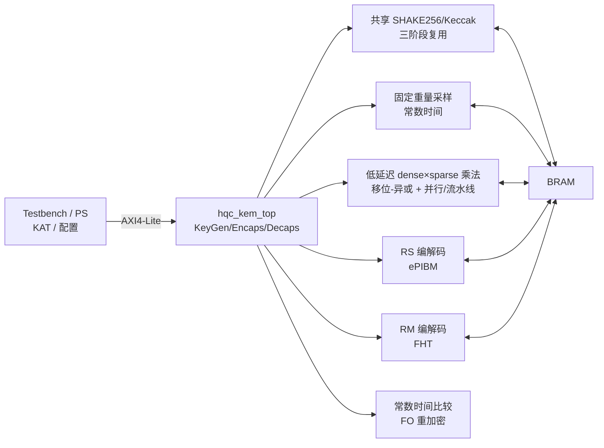

# HQC 技术路线与原创点

> 本文是 HQC KEM 大创的技术主线。读完后应能回答：
> ① HQC 在算什么；② 瓶颈在哪；③ 为什么稀疏结构能救乘法；④ 你的原创点是什么。
> 参数、填充、重复码等细节**以官方 HQC spec 与参考实现为准**；本文只给工程所需的全局图。

---

## 一、HQC 是什么

HQC（Hamming Quasi-Cyclic）是**基于准循环码的 KEM**，NIST 于 2025 年将其选为第五个后量子密码标准算法。它的安全性来自“解码随机准循环码”的困难性，属于**码密码**，不是格密码。

| 维度 | HQC | Kyber |
|:---|:---|:---|
| 困难问题 | 准循环码解码 | Module-LWE |
| 运算域 | $\mathrm{GF}(2)[X]/(X^n-1)$ | $\mathbb{Z}_q$，$q=3329$ |
| 核心 | 准循环乘法 + RM/RS 解码 | NTT + 模约减 |
| 你的旧论文 | 不适用 | FLUT+KRED |

**结论**：Kyber 的 FLUT+KRED 不能直接搬；但“从算法结构里找硬件简化”的方法完全适用。

---

## 二、参数与码结构

| 参数集 | n | k（字节） | w | w_r | w_e | RS 的 n1 |
|:---|:---|:---|:---|:---|:---|:---|
| HQC-128 | 17669 | 16 | 66 | 75 | 75 | 46 |
| HQC-192 | 35851 | 24 | 100 | 114 | 114 | 56 |
| HQC-256 | 57637 | 32 | 131 | 149 | 149 | 90 |

- `w`：私钥 x / y 的固定重量；
- `w_r`：加密随机向量 r1 / r2 的固定重量；
- `w_e`：误差 e 的固定重量；
- 码：Reed-Solomon（GF(2⁸)）× Reed-Muller RM(1,7)[128,8,64] × 重复码；
- `n` 为素数，级联码长度略小于 n，存在填充/缩短规则，**以官方 spec 为准**。

---

## 三、KEM 流程

### KeyGen

1. 生成种子，采样 x、y（重量 w）；
2. 生成稠密 h；
3. `s = x + h·y`（dense × sparse）；
4. 输出 `pk = (h, s)`，`sk = (x, y)`。

### Encaps

1. 随机 m；SHAKE 生成 r1、r2、e；
2. `u = r1 + h·r2`（dense × sparse）；
3. `v = Encode(m) + s·r2 + e`（dense × sparse）；
4. `c = (u, v)`；`K = SHAKE(m || c)`。

### Decaps

1. `w = v - u·y`（dense × sparse）；
2. 重复合并 → RM FHT → RS 解码 → m'；
3. 用 m' 重加密得 c'；
4. 常数时间比较 `c == c'`：成功走 `K = SHAKE(m' || c)`，失败走隐式拒绝 `K = SHAKE(σ || c)`。

> **注意**：Decaps 有一次重加密，所以 dense×sparse 乘法与 FHT 各跑两次；延迟预算按两次算。

---

## 四、瓶颈与硬件映射

> 老师选题简介：**稠密多项式乘法占核心计算时间 70% 以上**，要求**低延迟乘法器结构**；Karatsuba/Toom-Cook 只是老师举的例子，**不是硬性要求**。
> 本项目主方案：**HQC 的 dense×sparse 移位-异或低延迟乘法器**；Karatsuba/Toom-Cook 仅为老师举例，本项目**不实现对照**，避免范围膨胀。

| 运算 | 复杂度 | 硬件映射 | V0 放置 |
|:---|:---|:---|:---|
| GF(2) dense×sparse（主方案） | \(O(wn)\) | 循环移位 + XOR 累加 + 折叠；LANES/BRAM banking/流水线 | **RTL** |
| RM(1,7) 解码 | 每 128 bit 448 次加/减 | 128 点 FHT | **RTL** |
| RS 解码 | GF(2⁸) | **ePIBM** + Chien/Forney | **RTL** |
| SHAKE256 | Keccak-f[1600] | **三阶段共享核** | **RTL** |
| 固定重量采样 | 拒绝采样/位置生成 | 恒定时间采样器 | **RTL** |

### 关键结构性质 → 硬件

| HQC / 老师要求 | 硬件含义 |
|:---|:---|
| GF(2)，无进位 | 乘法 = AND，加法 = XOR，无进位链 |
| \(X^n \equiv 1\) | 高 half 循环折叠回低 half |
| **稠密多项式乘法是主瓶颈** | 低延迟乘法器；HQC 场景用 **dense×sparse shift-XOR** |
| 私钥/误差固定重量稀疏 | 按位置移位-异或，\(O(wn)\)；这是主方案 |
| 低延迟要求 | 并行 LANES、BRAM banking、地址偏移/桶形移位、流水线 XOR |
| RM(1,7) 是 Hadamard 结构 | 解码 = 128 点快速 Hadamard 变换 |
| RS 在 GF(2⁸) | 查表/复合域乘法，**ePIBM** 迭代 |
| 重复码 | 软值合并/多数表决 |
| 秘密位置/密文 | **恒定时间**访问与比较，不做秘密相关分支 |

---

## 五、推荐架构（V0：完整 RTL）

> 全 RTL，不再用 PS 做 SHAKE/RS/采样。
> 老师四项核心：低延迟 dense×sparse 乘法（Karatsuba/Toom-Cook 仅示例）、ePIBM/FHT、SHAKE 三阶段复用、恒定时间。
> 我们的增量：FPGA 全功能跑通 + ASIC 55/28/90nm + 设计空间。

### 模块清单

| 模块 | 功能 | 阶段 |
|:---|:---|:---|
| `sha3_shared` | 三阶段共享 SHAKE256/Keccak、XOF、PRNG | A/M3 |
| `sampler` | 固定重量采样（w/w_r/w_e），常数时间 | A/M3 |
| `poly_mult` | **低延迟 dense×sparse 主方案**（Karatsuba/Toom-Cook 仅为示例） | B/M2 |
| `sparse_qc_mult` | dense×sparse 核心实现（主方案） | B/M2 |
| `rs_codec` | RS 编码 + **ePIBM** 解码 | B/M4 |
| `rm_codec` | RM 编码 + FHT + 重复合并 | B/M4 |
| `hqc_kem_top` | KEM/PKE 控制、FO、隐式拒绝、常数时间比较 | A/M5 |
| `axi_mmio` | 寄存器/BRAM/DMA | A/M5 |

---

## 六、为什么乘法是核心：低延迟 dense×sparse 主方案

老师选题简介指出：**稠密多项式乘法占核心计算时间 70% 以上**，要求**低延迟乘法器结构**；Karatsuba/Toom-Cook 是举例，不是固定要求。因此：

- **主方案**：HQC 的 dense×sparse 乘法，按稀疏位置循环移位 + XOR 累加 + 折叠，\(O(wn)\)；
- **低延迟**：并行 LANES、BRAM banking、地址偏移/桶形移位、流水线 XOR、结果折叠；
- **不实现对照**：Karatsuba/Toom-Cook 只是老师举例，本项目直接做 dense×sparse，避免范围膨胀；
- **不允许**：把 Karatsuba/Toom-Cook 写成老师硬性要求或本项目原创。

HQC 的所有乘法都有一个**固定重量稀疏操作数**：

- KeyGen：`h·y`，y 重量 w；
- Encaps：`h·r2`、`s·r2`，r2 重量 w_r；
- Decaps：`u·y`，y 重量 w。

因此：

\[
a \cdot b = \bigoplus_{p \in \mathrm{supp}(b)} (a \lll p) \pmod{X^n-1}
\]

复杂度从 \(O(n^2)\) 降到 \(O(wn)\)。以 HQC-128 为例：

- 朴素：\(17669^2 \approx 3.1 \times 10^8\) 次 bit 运算；
- 稀疏：\(75 \times 17669 \approx 1.33 \times 10^6\) 次 XOR，约 **两个数量级** 的下降。

**架构研究点（可写的增量）**：

1. 并行路数 L（1/2/4/8/16）与 BRAM 端口/banking 的权衡；
2. 循环移位实现：桶形移位 vs 地址偏移 vs 位平面；
3. 位置表存储与读取（升序、无重复、16 bit）；
4. 流水线 XOR 累加与循环折叠顺序；
5. 面积-时间 Pareto 与能效；
6. SHAKE 三阶段共享 vs 独立的面积/延迟；
7. 恒定时间访问/比较的开销。

---

## 七、原创性与组内基线

**老师选题简介是技术基线**，以下都是老师给的，不是我们的原创：

- 低延迟乘法器结构（Karatsuba/Toom-Cook 仅为示例；本项目用 dense×sparse）；
- ePIBM + FHT 的 RS/RM 解码；
- SHAKE 三阶段资源复用；
- 恒定时间硬件架构与评估。

**组内 SOCC 2023 也是基线**：稀疏乘法、128-bit/4-bank、RM FHT、RS ePIBM、完整 HQC-128 KEM；19,794 LUT / 11,079 FF / 68 BRAM / 178 MHz；0.11/0.22/0.38 ms。

**我们的增量**（候选，需查新确认）：

1. ASIC 多工艺综合（55/28/90nm）与 FPGA/ASIC 对照；
2. 低延迟 dense×sparse 的设计空间/Pareto（LANES/BRAM/移位/流水线）；
3. SHAKE 共享/独立的面积-延迟权衡；
4. 恒定时间与资源复用的联合评估；
5. 参数化（HQC-128/192/256）与开源可复现。

**不能写**：“首次实现 HQC 硬件”“稀疏乘法是我们的创新”“完整 KEM 是我们的创新”“FPGA 全跑通是我们的创新”“低延迟乘法结构是我们的创新”“SHAKE 复用是我们的创新”“恒定时间是我们的创新”。

---

## 八、验证路线（完整 RTL）

> 完整 RTL + 官方 KAT 是 V0 闸门；**FPGA 全功能跑通是硬目标**；ASIC 是条件阶段（不流片）。

| 层级 | 对象 | 方法 | 通过标准 |
|:---|:---|:---|:---|
| L0 | C/C++ 黄金 | 官方参考 + 独立实现 | 逐 bit 一致 |
| L1 | dense×sparse 主方案 | 随机 dense + 稀疏位置 + C 黄金 | 1000 组 0 mismatch |
| L2 | RM/RS | 官方测试向量 | 逐块一致 |
| L3 | SHAKE 共享/采样 | 官方 KAT + 三阶段调度 | 逐字节一致；无死锁 |
| L4 | KeyGen/Encaps/Decaps | 官方 KAT + 负向 | 逐字节一致；隐式拒绝正确 |
| L5 | 恒定时间 | 时序方差/TVLA/人工审查 | 无秘密相关分支/提前返回 |
| L6 | 系统仿真 | 完整 RTL + KAT | 100/100；0 mismatch |
| L7 | FPGA 全功能跑通 + PPA | 板端 KAT + Vivado 综合/实现 | 板端 = 仿真；资源/时序/周期入档 |
| L8 | ASIC 综合（条件） | 55/28/90nm 综合 + area/power/fmax | 工具可用；不流片 |

国家级指标与证据口径见 `docs/10_团队分工与国家级指标.md`。

---

## 九、风险

- **低延迟 dense×sparse**：时序/面积可能不达标 → 先做单路原型，LANES/BRAM banking/移位实现做 Pareto。
- **范围控制**：不实现 Karatsuba/Toom-Cook 对照，避免膨胀；主方案直接做 dense×sparse。
- **SHAKE 共享**：三阶段串行可能变慢 → 共享 vs 独立对比，必要时双缓冲/部分共享。
- **恒定时间**：开销可能影响性能 → 先保证比较/采样/解码无分支，再评估 TVLA/时序。
- **KAT**：采样/填充/字节序必须官方；否则永远对不上。
- **FPGA 全功能跑通**：板卡未定、时序/外设难 → 尽早确认板卡，预留 4–6 周 bring-up。
- **ASIC**：PDK 有 55/28/90nm、工具待确认、团队无经验 → 前端综合评估必做；后端 P&R/STA 可选；不流片。
- **团队基础**：只学过数电+信号与系统 → 按 `docs/16` 先补 Verilog/C/GF(2)/RS-RM。

---

## 十、参考

- HQC 官方 spec 与参考实现（NIST 提交包 / HQC 官网）。
- 田静组论文 #15：An Efficient Hardware Design for Fast Implementation of HQC（SOCC 2023）。
- 田静组论文 #1/#2：Kyber 多项式乘法 / 可配置乘法器（方法论参考）。
- 田静组论文 #6：Kyber 模约减（“算法性质 → 硬件结构”的写法参考）。
- 本仓库：`docs/contracts/`、`docs/09_工程约束与验证规范.md`。
